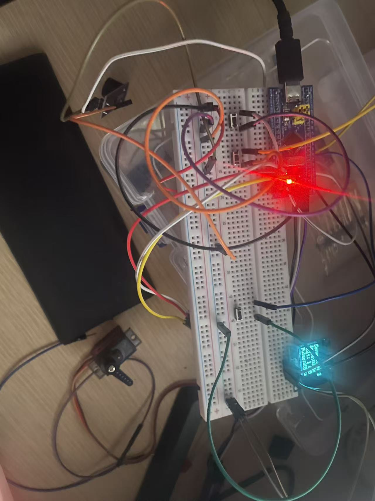

# STM32F103 舵机控制仪 · OLED 多页面 + 波形显示

**Servo controller with OLED UI and live waveform — STM32F103C8T6 + StdPeriph (SPL) + PlatformIO.**

按键调节舵机角度，OLED 实时显示角度 / 脉宽 / 电压，并把角度随时间的变化画成波形；另带一个不用万用表的自检页。

```
PlatformIO · framework = cmsis · STM32F103C8T6 (72MHz) · 标准外设库 (SPL)
```

<p align="center">
  
  <br>
  <sub>实物照片</sub>
</p>

---

## 功能一览

| 页面 | 内容 |
| --- | --- |
| **1 · Servo Control** | 当前角度、舵机脉宽（us）、电位器电压 |
| **2 · Waveform** | 最近 **12.8 秒**的角度波形（10 次/秒采样，从右往左滚动） |
| **3 · System Info** | 实测供电电压 VDD、电位器电压、**实际系统时钟与时钟源**（HSE / HSI） |
| **4 · Self Test** | PB6 引脚自检（不用仪表）、PB6→PA0 回环测 PWM、蜂鸣器通断测试 |

**操作**

- **左键（PA1）/ 右键（PA2）**：轻点走 5°；**按住连续调节**（约 100°/秒）
- **翻页键（PA3）**：1 → 2 → 3 → 4 → 1 循环
- 三个指示 LED 分别对应第 1/2/3 页（第 4 页全灭）

**实现上的几个点**

- **平滑运动**：按键只改"目标角度"，真正的脉宽由 **1ms 中断**连续逼近目标 —— 舵机是滑过去的，不会一格一格跳；而且平滑放在中断里，**不受屏幕刷新快慢影响**
- **电压测量**：用内部 1.20V 基准（VREFINT）实测 VDD 再换算，不写死 3.3V；换通道后丢弃首次转换，转换等待带超时
- **舵机 PWM**：预分频按**实际定时器时钟**计算，72 / 64 / 8MHz 下都是标准 50Hz
- **按键**：1ms 中断里做 10ms 消抖 + 事件队列，屏幕刷新再慢也不会漏按
- **蜂鸣器**：非阻塞（开→记截止时间→中断里关），不卡主循环

---

## 硬件连接

| 功能 | 引脚 | 说明 |
| --- | --- | --- |
| **舵机 PWM** | **PB6** | TIM4_CH1，50Hz / 0.5~2.5ms。**PB7 / PB8 / PB9 同时输出同样的信号**，插哪个都行 |
| **OLED** | **PA6 = SDA，PA7 = SCL** | SSD1306，软件 I2C（开漏输出） |
| **电位器** | **PA0** | ADC_IN0（10k 电位器：两端接 3V3 / GND，中间抽头接 PA0） |
| **按键** | **PA1** 左 / **PA2** 右 / **PA3** 翻页 | 内部上拉，按键另一端接 GND |
| **蜂鸣器** | **PB0** | 默认按**低电平触发**（`src/buzzer.c` 顶部有宏可切换） |
| **页面指示 LED** | **PB1 / PB12 / PB13** | 分别对应第 1 / 2 / 3 页 |

> ⚠️ **舵机请用 5V 供电**（MG90S、SG90 都是 4.8~6V），并且**必须和开发板共地**。
> 舵机堵转电流可达 1A，从板上 USB 取电时留意：如果舵机一动屏幕就闪/重启，请给舵机单独供 5V。

---

## 快速开始

```bash
git clone https://github.com/nsxsuek-jpg/stm32-servo-oled.git
cd stm32-servo-oled

pio run                 # 编译
pio run -t upload       # 用 ST-Link 烧录
```

依赖 [PlatformIO](https://platformio.org/)（VS Code 插件或 CLI 都可以）。工程已自带 CMSIS 与标准外设库，**clone 下来直接就能编译**。

---

## 目录结构

```
src/
├── main.c        主循环、系统时钟配置、四个页面的绘制
├── servo.c       舵机 PWM + 平滑运动（TIM4 四通道同理输出）
├── oled.c        SSD1306 软件 I2C 驱动 + 显存绘图
├── oled_font.c   8x16 ASCII 字库
├── adc.c         电位器电压 + 用 VREFINT 反推 VDD
├── key.c         按键扫描（1ms 中断消抖 + 事件队列）
├── buzzer.c      蜂鸣器（非阻塞，带触发极性宏）
├── delay.c       SysTick 1ms 节拍
└── spl/          标准外设库源文件（为什么放这里见该目录的 README）
include/          各模块头文件
lib/              CMSIS 与 SPL 的头文件（仅作"头文件仓库"用）
```

## 想改手感（都在文件顶部，一眼能找到）

| 想要的效果 | 改哪里 |
| --- | --- |
| 轻点一下走几度 | `src/main.c` → `ANGLE_STEP`（默认 5.0°） |
| 按住时的转速 | `src/servo.c` → `HOLD_TENTHS_PER_MS`（默认 100°/秒） |
| 跟手的"软硬" | `src/servo.c` → `SLEW_TENTHS_PER_MS`（默认 400°/秒，越小越软） |
| 波形时间窗 | `src/main.c` → `WAVE_PERIOD_MS`（默认 100ms，一屏 12.8 秒） |
| 主循环节拍 | `src/main.c` → `LOOP_MS`（默认 20ms） |
| 蜂鸣器触发极性 | `src/buzzer.c` → `BUZZER_ACTIVE_LOW` |
| 显示方向（模块倒装） | `src/oled.c` → `OLED_SEG_REMAP` / `OLED_COM_REMAP` |

---

## 踩过的坑

这些都是实际调出来的，代码注释里都有对应说明。

1. **`framework = cmsis` 提供的 `SystemInit()` 是空函数。**
   反汇编出来只有一条 `bx lr`，它**不会配置 PLL** —— 所以网上常见的 `-D SYSCLK_FREQ_72MHz` 在这里完全不起作用，芯片会一直跑在 HSI **8MHz**。
   表现：舵机 PWM 变成 5.56Hz、所有延时慢约 12 倍、屏幕刷新慢得肉眼可见。
   解决：在 `main()` 里显式调用 `SystemClock_Config()`（HSE 8MHz × 9 = 72MHz），并带 **HSE 起振重试**（SPL 的等待只有约 0.8ms，晶振常常来不及起振）和 **HSI/2×16 = 64MHz 兜底**，任何一步失败都不会卡死。

2. **`lib/` 目录其实不参与编译。**
   `platformio.ini` 里的 `-I lib/...` 让库依赖扫描（LDF）认为工程"没有依赖"，于是不会生成 `.a`、里面一个 `.c` 都不会被编译。真正参与链接的 SPL 源文件放在 **`src/spl/`** 下。

3. **OLED 的上电延时不能想当然。**
   原来是忙等 `OLED_DelayUs(100)`：8MHz 时实际约 2ms，勉强够 SSD1306 完成上电复位；主频提到 72MHz 后同样的循环只剩 **0.23ms**，初始化直接失败（花屏 / 黑屏）。改成真正的 100ms 才正常。

4. **软件 I2C 的整屏刷新是主循环瓶颈。**
   画一页要写 780 多字节、60ms 以上，按键就会"慢半拍"。改成**只重画变化的字段**后，主循环从约 80ms 降到约 25ms。

5. **舵机"一格一格"跳。**
   原来是每 50ms 直接跳 5°，舵机 8ms 就到位、然后干等 42ms，看起来像时钟走针。改成"目标角度 + 1ms 中断里平滑逼近"。

6. **舵机 PWM 的预分频不要写死 72。**
   按实际定时器时钟（读 `RCC->CFGR` 算 APB1 分频）计算，这样 72MHz / 64MHz / 8MHz 下都是标准 50Hz。

7. **硬件上最容易踩的坑**
   - **杜邦线内部断线**：插着但电气上没接通，现象是"信号完全没反应"，最难查 —— 换一根线就好了；
   - 三针蜂鸣器模块有**高电平触发**和**低电平触发**两种，接错就是"一直响"；
   - 舵机的 5V 必须**和板子共地**，否则完全不动。

---

## 许可

本项目采用 **MIT License**，版权所有 © 2026 **nsxsuek-jpg**，详见 [LICENSE](LICENSE)。

> `lib/` 下的 CMSIS 与标准外设库（SPL）来自 STMicroelectronics，版权归 ST 所有，按其原始许可分发。
