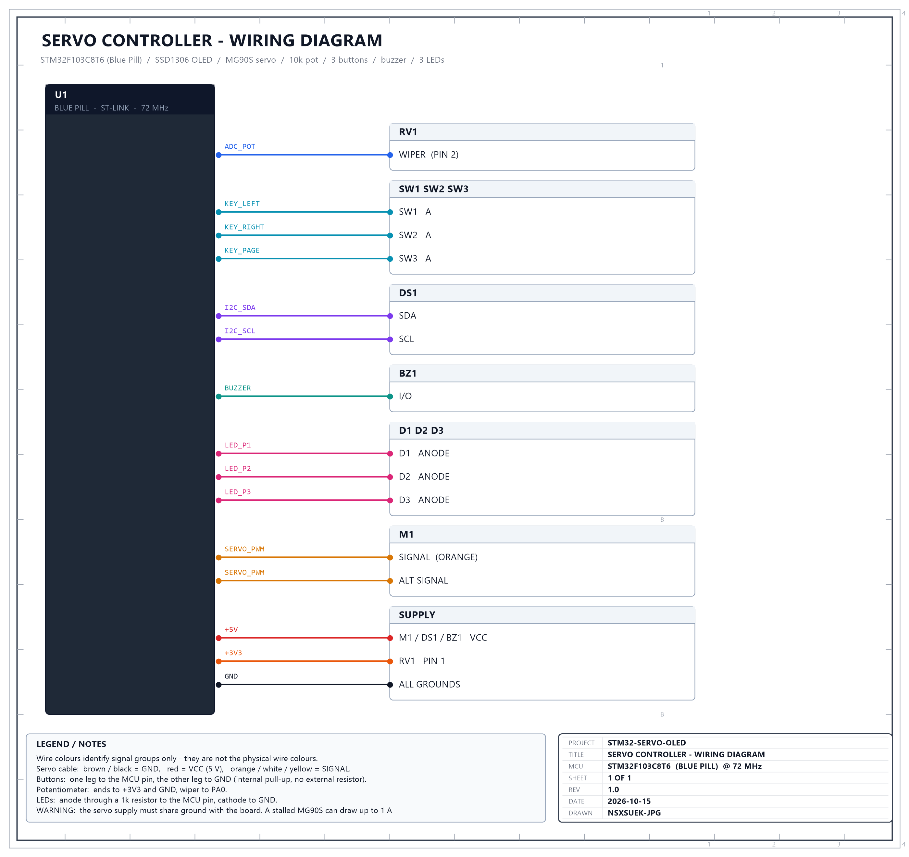

# STM32F103 Servo Controller · Multi-page OLED UI + Live Waveform

**English** | [简体中文](README.zh-CN.md)

A small servo-control project on an **STM32F103C8T6** using the **Standard Peripheral Library (SPL)**: adjust the servo angle with push buttons, watch angle / pulse width / voltage on an OLED, and see the angle plotted as a scrolling waveform. It also ships with a self-test page that needs no multimeter.

```
PlatformIO · framework = cmsis · STM32F103C8T6 (72 MHz) · StdPeriph (SPL)
```

<p align="center">
  
  <br>
  <sub>Photo of the setup</sub>
</p>

---

## Features

| Page | Contents |
| --- | --- |
| **1 · Servo Control** | Current angle, servo pulse width (µs), potentiometer voltage |
| **2 · Waveform** | Angle history of the last **12.8 s** (10 samples/s, scrolling right → left) |
| **3 · System Info** | Measured supply voltage VDD, potentiometer voltage, **actual system clock and its source** (HSE / HSI) |
| **4 · Self Test** | PB6 pin self-test (no instruments), PB6 → PA0 loopback PWM check, buzzer continuity check |

**Controls**

- **Left button (PA1) / Right button (PA2)**: tap = 5°; **hold = continuous** (~100 °/s)
- **Page button (PA3)**: cycles 1 → 2 → 3 → 4 → 1
- The three indicator LEDs correspond to pages 1 / 2 / 3 (all off on page 4)

**Implementation notes**

- **Smooth motion**: the buttons only move a *target* angle; the actual pulse width is slewed toward it from a **1 ms interrupt**, so the servo glides instead of stepping. Because the slew runs in the interrupt it stays smooth **no matter how slow the display refresh is**
- **Voltage measurement**: VDD is derived from the internal 1.20 V reference (VREFINT) instead of hard-coding 3.3 V; the first conversion after a channel switch is discarded, and every conversion wait has a timeout
- **Servo PWM**: the prescaler is computed from the **actual timer clock**, so it stays a true 50 Hz at 72 / 64 / 8 MHz
- **Buttons**: 10 ms debounce plus an event queue inside a 1 ms interrupt — no press is lost even if the display refresh is slow
- **Buzzer**: non-blocking (on → deadline → off from the interrupt), never stalls the main loop

---

## Wiring



> Drawn as an engineering sheet: bordered frame with zone marks, a title block, reference designators (`U1` MCU / `M1` servo / `DS1` OLED / `SW1-3` buttons / `RV1` pot / `BZ1` buzzer / `D1-3` LEDs) and a net label on every wire (`SERVO_PWM`, `I2C_SDA`, `ADC_POT`, ...).
> Generated by `tools/draw_wiring.ps1` — edit the data arrays and re-run to change it.

| Function | Pin | Notes |
| --- | --- | --- |
| **Servo PWM** | **PB6** | TIM4_CH1, 50 Hz / 0.5–2.5 ms. **PB7 / PB8 / PB9 output the identical signal**, so any of them works |
| **OLED** | **PA6 = SDA, PA7 = SCL** | SSD1306, bit-banged I²C (open-drain) |
| **Potentiometer** | **PA0** | ADC_IN0 (10 kΩ: ends to 3V3 / GND, wiper to PA0) |
| **Buttons** | **PA1** left / **PA2** right / **PA3** page | Internal pull-up, the other side goes to GND |
| **Buzzer** | **PB0** | Assumes an **active-low** module (a macro at the top of `src/buzzer.c` flips it) |
| **Page LEDs** | **PB1 / PB12 / PB13** | Pages 1 / 2 / 3 |

> ⚠️ **Power the servo from 5 V** (MG90S and SG90 are 4.8–6 V) and **share ground with the board**.
> A stalled servo can draw 1 A. If the screen flickers or the board resets when the servo moves, give the servo its own 5 V supply.

---

## Getting started

```bash
git clone https://github.com/nsxsuek-jpg/stm32-servo-oled.git
cd stm32-servo-oled

pio run                 # build
pio run -t upload       # flash with an ST-Link
```

Requires [PlatformIO](https://platformio.org/) (VS Code extension or CLI). CMSIS and the StdPeriph library are vendored in the repo, so it **builds right after cloning**.

### Prebuilt firmware

Don't want to build it yourself? Grab `stm32-servo-oled-v1.0.0.bin` from the [latest release](https://github.com/nsxsuek-jpg/stm32-servo-oled/releases/latest) and flash it at **`0x08000000`**:

```bash
st-flash write stm32-servo-oled-v1.0.0.bin 0x08000000
```

STM32CubeProgrammer and friends work too — just use `0x08000000` as the address.

---

## Project layout

```
src/
├── main.c        main loop, system clock setup, the four page renderers
├── servo.c       servo PWM + smooth motion (all four TIM4 channels)
├── oled.c        SSD1306 bit-banged I²C driver + frame buffer drawing
├── oled_font.c   8x16 ASCII font
├── adc.c         potentiometer voltage + VDD derived from VREFINT
├── key.c         button scanning (1 ms interrupt debounce + event queue)
├── buzzer.c      buzzer (non-blocking, with a trigger-polarity macro)
├── delay.c       SysTick 1 ms tick
└── spl/          StdPeriph library sources (see the README in that folder)
include/          module headers
lib/              CMSIS and SPL headers (kept purely as a header source)
docs/             photos and the wiring diagram (wiring.png is generated by tools/draw_wiring.ps1)
tools/            helper scripts
```

## Tuning

| What you want | Where to change it |
| --- | --- |
| Degrees per tap | `src/main.c` → `ANGLE_STEP` (default 5.0°) |
| Speed while holding | `src/servo.c` → `HOLD_TENTHS_PER_MS` (default 100 °/s) |
| Tracking "stiffness" | `src/servo.c` → `SLEW_TENTHS_PER_MS` (default 400 °/s; smaller = softer) |
| Waveform time window | `src/main.c` → `WAVE_PERIOD_MS` (default 100 ms → 12.8 s per screen) |
| Main loop period | `src/main.c` → `LOOP_MS` (default 20 ms) |
| Buzzer trigger polarity | `src/buzzer.c` → `BUZZER_ACTIVE_LOW` |
| Display orientation (module mounted upside down) | `src/oled.c` → `OLED_SEG_REMAP` / `OLED_COM_REMAP` |

---

## Pitfalls I ran into

All of these were found the hard way, and each one is explained in the code comments.

1. **`SystemInit()` shipped with `framework = cmsis` is an empty function.**
   It disassembles to a single `bx lr` and does **not configure the PLL** — so the widely copied `-D SYSCLK_FREQ_72MHz` does nothing here, and the chip happily keeps running on the HSI at **8 MHz**.
   Symptoms: the servo PWM becomes 5.56 Hz, every delay is ~12× too long, and the display refresh is visibly slow.
   Fix: call `SystemClock_Config()` explicitly from `main()` (HSE 8 MHz × 9 = 72 MHz), with a **HSE startup retry** (the SPL wait is only ~0.8 ms while a crystal typically needs 1–2 ms) and an **HSI/2 × 16 = 64 MHz fallback**. Every step has a timeout, so nothing hangs.

2. **The `lib/` folder is not actually compiled.**
   The `-I lib/...` flags in `platformio.ini` make the library dependency finder (LDF) believe the project "has no dependencies", so no `.a` is produced and **not a single `.c` inside is compiled**. The SPL sources that actually get linked live in **`src/spl/`**.

3. **Don't guess the OLED power-on delay.**
   It used to busy-wait `OLED_DelayUs(100)`: about 2 ms at 8 MHz, which was barely enough for the SSD1306 power-on reset; at 72 MHz the same loop is only **0.23 ms** and initialisation fails outright (garbled or blank screen). A real 100 ms delay fixes it.

4. **A full-screen bit-banged I²C refresh is the main-loop bottleneck.**
   Drawing one page writes 780+ bytes and takes over 60 ms, which made the buttons feel laggy. Redrawing **only the fields that changed** cut the loop from ~80 ms to ~25 ms.

5. **The servo moved in visible steps.**
   The old code jumped 5° every 50 ms: the servo reached the new position in 8 ms and then sat idle for 42 ms, which looks like a ticking clock. Replaced with "target angle + smooth approach from a 1 ms interrupt".

6. **Never hard-code the servo PWM prescaler to 72.**
   Compute it from the actual timer clock (read `RCC->CFGR` to find the APB1 divider) so it stays a true 50 Hz at 72 / 64 / 8 MHz.

7. **The hardware traps that cost the most time**
   - **Broken jumper wires**: plugged in but not electrically connected — the symptom is "the signal does absolutely nothing" and it is the hardest thing to find. Swapping the wire fixes it.
   - Three-pin buzzer modules come in **active-high and active-low** flavours; pick the wrong one and it just screams continuously.
   - The servo's 5 V supply must **share ground with the board**, otherwise it will not move at all.

---

## License

Released under the **MIT License**, Copyright © 2026 **nsxsuek-jpg** — see [LICENSE](LICENSE).

> CMSIS and the StdPeriph library (SPL) under `lib/` come from STMicroelectronics and remain under their original licenses.
